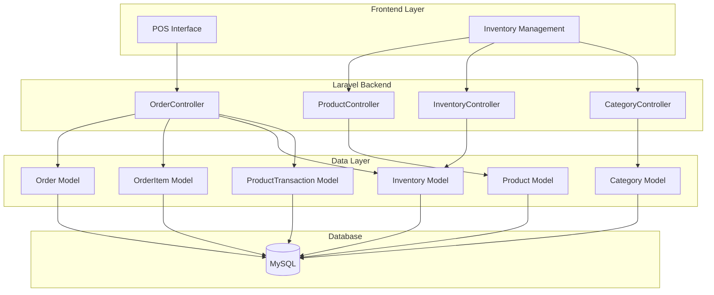
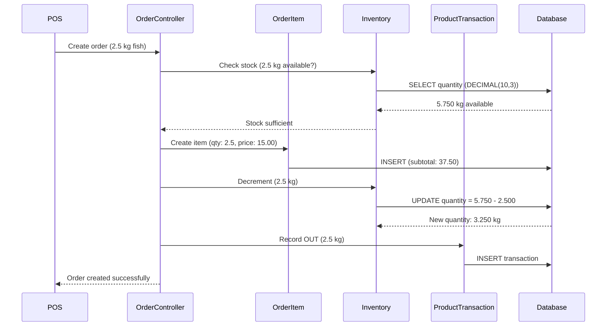
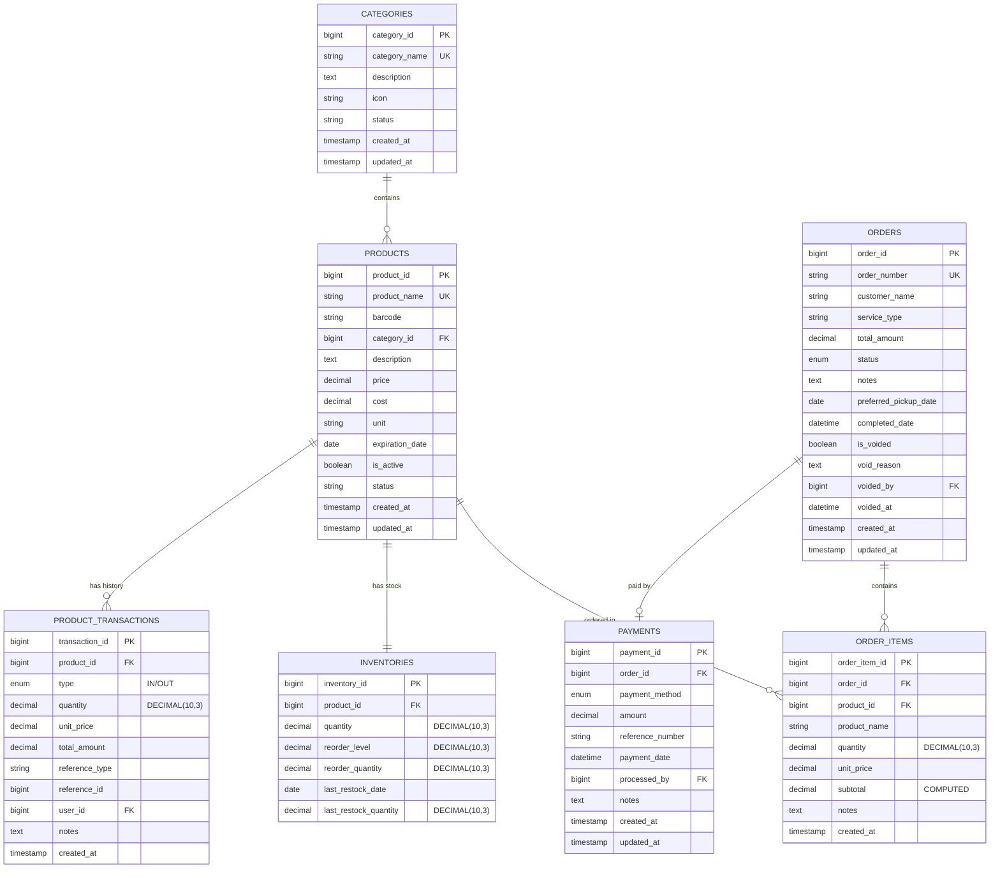

# Design Document: Seafood Product Expansion

## Overview

This design extends the existing Laravel-based product and category management system to support seafood products and related supplies. The core enhancement introduces **decimal quantity support** for per-kilo seafood products, enabling fractional weight sales (e.g., 2.5 kg of fish) while maintaining data integrity across the order, inventory, and transaction systems.

### Key Design Goals

1. **Decimal Precision**: Support fractional quantities with 3 decimal places (e.g., 2.750 kg)
2. **Data Integrity**: Maintain consistency across orders, inventory, and transactions
3. **Backward Compatibility**: Preserve existing integer-based product functionality
4. **Performance**: Minimize impact on existing caching and query optimization
5. **Regulatory Readiness**: Support seafood-specific attributes (expiration dates, storage requirements)

### Scope

**In Scope:**
- Database schema modifications for decimal quantity support
- Model updates for decimal casting and validation
- Controller logic for fractional inventory management
- New seafood and support categories
- Database seeders for initial data

**Out of Scope:**
- Frontend UI changes (handled separately)
- Barcode scanning hardware integration
- Advanced analytics for seafood-specific metrics
- Multi-warehouse inventory management

## Architecture

### System Context



### Component Architecture

The system follows Laravel's MVC pattern with the following key components:

1. **Controllers**: Handle HTTP requests and orchestrate business logic
2. **Models**: Represent database entities with relationships and computed attributes
3. **Migrations**: Define database schema changes
4. **Seeders**: Populate initial data for categories and products
5. **Cache Service**: Manages cache invalidation for performance optimization

### Decimal Quantity Flow



## Components and Interfaces

### 1. Database Schema Changes

#### Migration: Modify `order_items` Table

**File**: `database/migrations/YYYY_MM_DD_HHMMSS_modify_order_items_for_decimal_quantities.php`

```php
Schema::table('order_items', function (Blueprint $table) {
    // Change quantity from integer to decimal(10,3)
    $table->decimal('quantity', 10, 3)->change();
    
    // Update subtotal calculation to handle decimal quantities
    // Drop existing computed column and recreate
    $table->dropColumn('subtotal');
});

Schema::table('order_items', function (Blueprint $table) {
    $table->decimal('subtotal', 10, 2)
          ->storedAs('ROUND(quantity * unit_price, 2)')
          ->after('unit_price');
});
```

**Rationale**: 
- `DECIMAL(10,3)` supports quantities from 0.001 to 9999999.999
- Subtotal uses `ROUND()` to ensure 2 decimal place precision for currency
- Separate `ALTER TABLE` statements avoid MySQL computed column limitations

#### Migration: Modify `inventories` Table

```php
Schema::table('inventories', function (Blueprint $table) {
    $table->decimal('quantity', 10, 3)->change();
    $table->decimal('reorder_level', 10, 3)->nullable()->change();
    $table->decimal('reorder_quantity', 10, 3)->nullable()->change();
    $table->decimal('last_restock_quantity', 10, 3)->nullable()->change();
});
```

**Rationale**: All quantity-related fields must support decimals for consistency.

#### Migration: Modify `product_transactions` Table

```php
Schema::table('product_transactions', function (Blueprint $table) {
    $table->decimal('quantity', 10, 3)->change();
});
```

**Rationale**: Transaction history must preserve exact fractional quantities.

#### Migration: Add Seafood Categories

```php
// Handled by seeder - no schema changes needed
// Categories table already supports all required fields
```

### 2. Model Updates

#### OrderItem Model

**File**: `app/Models/OrderItem.php`

**Changes**:
```php
protected $casts = [
    'quantity' => 'decimal:3',      // Changed from 'integer'
    'unit_price' => 'decimal:2',
    'subtotal' => 'decimal:2',
];

// Update computed attribute to handle decimals
public function getSubtotalAttribute()
{
    return round($this->quantity * $this->unit_price, 2);
}
```

**Validation Rules** (in OrderController):
```php
'order_items.*.quantity' => 'required|numeric|min:0.001|max:9999.999|regex:/^\d+(\.\d{1,3})?$/',
```

**Rationale**: 
- Cast to `decimal:3` preserves 3 decimal places
- Regex ensures max 3 decimal places
- Min value 0.001 prevents zero quantities

#### Inventory Model

**File**: `app/Models/Inventory.php`

**Changes**:
```php
protected $casts = [
    'quantity' => 'decimal:3',              // Changed from 'integer'
    'reorder_level' => 'decimal:3',         // Changed from 'integer'
    'reorder_quantity' => 'decimal:3',      // Changed from 'integer'
    'last_restock_quantity' => 'decimal:3', // Changed from 'integer'
    'last_restock_date' => 'date',
];

// Update status logic to handle decimal comparisons
public function getStatusAttribute()
{
    if ($this->quantity <= 0) {
        return 'out';
    } elseif ($this->quantity <= $this->reorder_level) {
        return 'low';
    } else {
        return 'available';
    }
}
```

**Rationale**: Decimal comparisons work correctly with `<=` operator.

#### ProductTransaction Model

**File**: `app/Models/ProductTransaction.php`

**Changes**:
```php
protected $casts = [
    'quantity' => 'decimal:3',       // Changed from 'integer'
    'unit_price' => 'decimal:2',
    'total_amount' => 'decimal:2',
];
```

### 3. Controller Logic Updates

#### OrderController

**File**: `app/Http/Controllers/OrderController.php`

**Key Changes**:

1. **Stock Validation** (in `store` method):
```php
// Use bccomp for precise decimal comparison
if (bccomp($inventory->quantity, $item['quantity'], 3) < 0) {
    return response()->json([
        'error' => 'Insufficient stock',
        'product_name' => $inventory->product->product_name,
        'available' => $inventory->quantity,
        'requested' => $item['quantity']
    ], 422);
}
```

2. **Inventory Decrement**:
```php
// Use DB::raw for precise decimal arithmetic
Inventory::where('product_id', $item['product_id'])
    ->update([
        'quantity' => DB::raw("quantity - {$item['quantity']}")
    ]);
```

3. **Validation Rules**:
```php
'order_items.*.quantity' => [
    'required',
    'numeric',
    'min:0.001',
    'max:9999.999',
    'regex:/^\d+(\.\d{1,3})?$/'
],
```

**Rationale**:
- `bccomp()` avoids floating-point precision issues
- `DB::raw()` ensures database-level precision
- Regex validation prevents invalid decimal formats

#### InventoryController

**File**: `app/Http/Controllers/InventoryController.php`

**Key Changes**:

1. **Restock Validation**:
```php
$validated = $request->validate([
    'quantity' => [
        'required',
        'numeric',
        'min:0.001',
        'max:9999.999',
        'regex:/^\d+(\.\d{1,3})?$/'
    ],
]);
```

2. **Inventory Update**:
```php
$inventory->update([
    'quantity' => DB::raw("quantity + {$validated['quantity']}"),
    'last_restock_quantity' => $validated['quantity'],
    'last_restock_date' => now(),
]);
```

### 4. Category and Product Seeders

#### CategorySeeder

**File**: `database/seeders/SeafoodCategorySeeder.php`

```php
class SeafoodCategorySeeder extends Seeder
{
    public function run()
    {
        $categories = [
            [
                'category_name' => 'Fresh Seafood',
                'description' => 'Fresh fish and seafood products requiring refrigeration',
                'icon' => '🐟',
                'status' => 'active'
            ],
            [
                'category_name' => 'Frozen Seafood',
                'description' => 'Frozen seafood products for extended storage',
                'icon' => '❄️',
                'status' => 'active'
            ],
            [
                'category_name' => 'Shellfish',
                'description' => 'Clams, mussels, oysters, and other shellfish',
                'icon' => '🦪',
                'status' => 'active'
            ],
            [
                'category_name' => 'Crustaceans',
                'description' => 'Crabs, lobsters, shrimp, and prawns',
                'icon' => '🦞',
                'status' => 'active'
            ],
            [
                'category_name' => 'Fish',
                'description' => 'Various fish species for sale',
                'icon' => '🐠',
                'status' => 'active'
            ],
            [
                'category_name' => 'Ice & Cooling',
                'description' => 'Ice and cooling supplies for seafood preservation',
                'icon' => '🧊',
                'status' => 'active'
            ],
            [
                'category_name' => 'Cleaning Supplies',
                'description' => 'Cleaning products for seafood handling areas',
                'icon' => '🧹',
                'status' => 'active'
            ],
            [
                'category_name' => 'Packaging Materials',
                'description' => 'Bags, containers, and wrapping for seafood',
                'icon' => '📦',
                'status' => 'active'
            ],
            [
                'category_name' => 'Seafood Equipment',
                'description' => 'Tools and equipment for seafood handling',
                'icon' => '🔪',
                'status' => 'active'
            ],
        ];

        foreach ($categories as $category) {
            Category::firstOrCreate(
                ['category_name' => $category['category_name']],
                $category
            );
        }
    }
}
```

#### ProductSeeder

**File**: `database/seeders/SeafoodProductSeeder.php`

```php
class SeafoodProductSeeder extends Seeder
{
    public function run()
    {
        $freshSeafoodCategory = Category::where('category_name', 'Fresh Seafood')->first();
        $iceCategory = Category::where('category_name', 'Ice & Cooling')->first();
        $cleaningCategory = Category::where('category_name', 'Cleaning Supplies')->first();

        $products = [
            // Fresh Seafood
            [
                'product_name' => 'Fresh Tilapia',
                'category_id' => $freshSeafoodCategory->category_id,
                'description' => 'Fresh tilapia fish. Storage: Keep refrigerated at 0-4°C. Shelf life: 2-3 days.',
                'price' => 180.00,
                'cost' => 120.00,
                'unit' => 'kg',
                'expiration_date' => now()->addDays(2),
                'is_active' => true,
                'status' => 'active'
            ],
            [
                'product_name' => 'Fresh Bangus (Milkfish)',
                'category_id' => $freshSeafoodCategory->category_id,
                'description' => 'Fresh milkfish. Storage: Keep refrigerated at 0-4°C. Shelf life: 2-3 days.',
                'price' => 160.00,
                'cost' => 100.00,
                'unit' => 'kg',
                'expiration_date' => now()->addDays(2),
                'is_active' => true,
                'status' => 'active'
            ],
            [
                'product_name' => 'Fresh Squid',
                'category_id' => $freshSeafoodCategory->category_id,
                'description' => 'Fresh squid. Storage: Keep refrigerated at 0-4°C. Shelf life: 1-2 days.',
                'price' => 250.00,
                'cost' => 180.00,
                'unit' => 'kg',
                'expiration_date' => now()->addDays(1),
                'is_active' => true,
                'status' => 'active'
            ],
            // Ice & Cooling
            [
                'product_name' => 'Ice Blocks (5kg)',
                'category_id' => $iceCategory->category_id,
                'description' => 'Large ice blocks for seafood display and preservation',
                'price' => 50.00,
                'cost' => 20.00,
                'unit' => 'block',
                'is_active' => true,
                'status' => 'active'
            ],
            [
                'product_name' => 'Crushed Ice',
                'category_id' => $iceCategory->category_id,
                'description' => 'Crushed ice for seafood display',
                'price' => 30.00,
                'cost' => 10.00,
                'unit' => 'kg',
                'is_active' => true,
                'status' => 'active'
            ],
            // Cleaning Supplies
            [
                'product_name' => 'Seafood Surface Sanitizer',
                'category_id' => $cleaningCategory->category_id,
                'description' => 'Food-safe sanitizer for seafood preparation surfaces',
                'price' => 150.00,
                'cost' => 80.00,
                'unit' => 'bottle',
                'is_active' => true,
                'status' => 'active'
            ],
        ];

        foreach ($products as $productData) {
            $product = Product::firstOrCreate(
                ['product_name' => $productData['product_name']],
                $productData
            );

            // Create inventory record if it doesn't exist
            Inventory::firstOrCreate(
                ['product_id' => $product->product_id],
                [
                    'quantity' => 0,
                    'reorder_level' => 5.000,
                    'reorder_quantity' => 20.000,
                ]
            );
        }
    }
}
```

## Data Models

### Entity Relationship Diagram



### Key Data Constraints

1. **Decimal Precision**:
   - Quantities: `DECIMAL(10,3)` - supports 0.001 to 9999999.999
   - Prices: `DECIMAL(10,2)` - supports 0.01 to 99999999.99
   - Subtotals: Computed with `ROUND(quantity * unit_price, 2)`

2. **Foreign Key Constraints**:
   - `products.category_id` → `categories.category_id` (RESTRICT on delete)
   - `order_items.product_id` → `products.product_id` (RESTRICT on delete)
   - `inventories.product_id` → `products.product_id` (CASCADE on delete)

3. **Unique Constraints**:
   - `categories.category_name` (max 50 characters)
   - `products.product_name` (max 100 characters)
   - `orders.order_number`

4. **Check Constraints** (enforced at application level):
   - `quantity > 0` for order items
   - `quantity >= 0` for inventory
   - `price >= 0` for products
   - `expiration_date > current_date` for new products

## Correctness Properties

*A property is a characteristic or behavior that should hold true across all valid executions of a system—essentially, a formal statement about what the system should do. Properties serve as the bridge between human-readable specifications and machine-verifiable correctness guarantees.*


### Property Reflection

After analyzing all acceptance criteria, I identified the following redundancies and consolidations:

**Redundancies Identified:**

1. **Cache Invalidation Properties** (1.4, 5.4, 8.4, 12.1, 12.2): All test that cache is cleared on entity updates. These can be consolidated into a single comprehensive cache invalidation property.

2. **Category Deletion Prevention** (1.5, 11.2): Both test the same referential integrity constraint. Property 11.2 is redundant.

3. **Inventory Decimal Operations** (13.5, 13.6): Both test decimal arithmetic for inventory changes. These can be combined into a single property about inventory decimal precision.

4. **Product Retrieval with Relationships** (8.2): This is a basic ORM behavior that's already tested by the framework. Not a unique business rule.

5. **is_active Status Calculation** (3.6, 4.2, 4.3): These all test the same business rule about is_active status. Can be consolidated into one comprehensive property.

6. **Uniqueness Validation** (1.3, 3.4): Both test uniqueness constraints. Can be generalized into a single property about entity uniqueness.

**Properties to Keep (After Consolidation):**

- Decimal quantity precision and range validation (13.1, 13.2)
- Subtotal calculation accuracy (13.3)
- Inventory decimal arithmetic (13.5, 13.6 combined)
- Inventory validation before order completion (13.9)
- Round-trip inventory restoration on void/cancel (13.10)
- Cache invalidation on entity changes (1.4, 5.4, 8.4, 12.1, 12.2 combined)
- Category deletion prevention with products (1.5)
- Error message content on deletion failure (11.3)
- Historical data preservation (4.5, 11.4 combined)
- Product is_active status calculation (3.6, 4.2, 4.3 combined)
- Uniqueness enforcement (1.3, 3.4 combined)
- Automatic inventory creation (3.3)
- Expiration date validation (3.5)
- Reorder level flagging (7.4)
- Barcode exact match search (8.1)
- Product ordering (8.5)
- Category product count accuracy (9.1)
- Category filtering (9.2)
- Seeder idempotency (10.6)
- Transaction decimal precision (13.8)

### Property 1: Decimal Quantity Precision and Range Validation

*For any* order item creation with a quantity value, the system SHALL accept decimal values with up to 3 decimal places and SHALL reject values outside the range (0, 9999.999].

**Validates: Requirements 13.1, 13.2**

### Property 2: Subtotal Calculation Accuracy

*For any* order item with quantity Q and unit_price P, the computed subtotal SHALL equal ROUND(Q × P, 2) with exactly 2 decimal places.

**Validates: Requirements 13.3**

### Property 3: Inventory Decimal Arithmetic Precision

*For any* inventory increment or decrement operation with a fractional quantity Q, the resulting inventory quantity SHALL reflect the exact change of ±Q with 3 decimal place precision (no rounding errors).

**Validates: Requirements 13.4, 13.5, 13.6**

### Property 4: Inventory Validation Before Order Completion

*For any* order creation attempt, if any order item quantity Q exceeds the available inventory quantity I for that product, the system SHALL reject the entire order and return an error indicating insufficient stock.

**Validates: Requirements 13.9**

### Property 5: Round-Trip Inventory Restoration on Void/Cancel

*For any* completed order that is subsequently voided or cancelled, the inventory quantities for all products SHALL be restored to their exact pre-order values (accounting for any intervening transactions).

**Validates: Requirements 13.10**

### Property 6: Cache Invalidation on Entity Changes

*For any* create, update, or delete operation on products or categories, all related cache entries SHALL be immediately invalidated.

**Validates: Requirements 1.4, 5.4, 8.4, 12.1, 12.2**

### Property 7: Category Deletion Prevention with Products

*For any* category that has one or more associated products, deletion attempts SHALL be rejected with an error.

**Validates: Requirements 1.5, 11.2**

### Property 8: Error Message Content on Deletion Failure

*For any* category deletion attempt that fails due to associated products, the error message SHALL include the count of products preventing deletion.

**Validates: Requirements 11.3**

### Property 9: Historical Data Preservation

*For any* product that is deleted or expires, all associated records in order_items and product_transactions tables SHALL be preserved unchanged.

**Validates: Requirements 4.5, 11.4**

### Property 10: Product is_active Status Calculation

*For any* product, the is_active status SHALL be true if and only if (expiration_date is NULL OR expiration_date > current_date) AND inventory quantity > 0.

**Validates: Requirements 3.6, 4.2, 4.3**

### Property 11: Entity Uniqueness Enforcement

*For any* category or product creation/update, the system SHALL reject operations that would create duplicate names (case-insensitive) and SHALL enforce maximum length constraints (50 chars for categories, 100 chars for products).

**Validates: Requirements 1.3, 3.4**

### Property 12: Automatic Inventory Creation

*For any* product creation, the system SHALL automatically create an associated inventory record with quantity initialized to 0.

**Validates: Requirements 3.3**

### Property 13: Expiration Date Future Validation

*For any* product creation or update with an expiration_date value, the system SHALL reject dates that are not in the future relative to the current date.

**Validates: Requirements 3.5**

### Property 14: Reorder Level Flagging

*For any* product with inventory quantity Q and reorder_level R, the inventory status SHALL be 'low' when Q ≤ R and Q > 0, 'out' when Q ≤ 0, and 'available' otherwise.

**Validates: Requirements 7.4**

### Property 15: Barcode Exact Match Search

*For any* barcode search query B, the system SHALL return only products where the barcode field exactly equals B (case-sensitive).

**Validates: Requirements 8.1**

### Property 16: Product Ordering by Creation Date

*For any* product list retrieval, products SHALL be ordered by created_at timestamp in descending order (newest first).

**Validates: Requirements 8.5**

### Property 17: Category Product Count Accuracy

*For any* category retrieval, the returned product count SHALL equal the actual number of products with that category_id in the products table.

**Validates: Requirements 9.1**

### Property 18: Category Filtering Correctness

*For any* product filtering by category_id C, the result set SHALL contain only products where category_id = C and SHALL contain all such products.

**Validates: Requirements 9.2**

### Property 19: Seeder Idempotency

*For any* execution of the seafood category and product seeders, running the seeder multiple times SHALL NOT create duplicate categories or products (based on unique name constraints).

**Validates: Requirements 10.6**

### Property 20: Transaction Decimal Precision

*For any* product transaction record, the quantity field SHALL be stored with exactly 3 decimal places of precision, preserving fractional values without rounding.

**Validates: Requirements 13.8**

## Error Handling

### Validation Errors

**Decimal Quantity Validation**:
```php
// In OrderController validation
'order_items.*.quantity' => [
    'required',
    'numeric',
    'min:0.001',
    'max:9999.999',
    'regex:/^\d+(\.\d{1,3})?$/'
],

// Error Response
{
    "message": "The order items.0.quantity must be between 0.001 and 9999.999.",
    "errors": {
        "order_items.0.quantity": [
            "The quantity must be a number with up to 3 decimal places."
        ]
    }
}
```

**Insufficient Stock Error**:
```php
// In OrderController::store()
if (bccomp($inventory->quantity, $item['quantity'], 3) < 0) {
    return response()->json([
        'error' => 'Insufficient stock',
        'product_name' => $inventory->product->product_name,
        'product_id' => $item['product_id'],
        'available' => $inventory->quantity,
        'requested' => $item['quantity']
    ], 422);
}
```

**Category Deletion with Products**:
```php
// In CategoryController::destroy()
$productCount = $category->products()->count();
if ($productCount > 0) {
    return response()->json([
        'error' => 'Cannot delete category',
        'message' => "This category has {$productCount} associated products. Please reassign or delete the products first.",
        'product_count' => $productCount
    ], 422);
}
```

**Expiration Date Validation**:
```php
// In ProductController validation
'expiration_date' => 'nullable|date|after:today',

// Error Response
{
    "message": "The expiration date must be a date after today.",
    "errors": {
        "expiration_date": [
            "The expiration date must be in the future."
        ]
    }
}
```

### Database Errors

**Foreign Key Constraint Violation**:
```php
try {
    $product = Product::create($validated);
} catch (\Illuminate\Database\QueryException $e) {
    if ($e->getCode() === '23000') {
        return response()->json([
            'error' => 'Invalid category',
            'message' => 'The specified category does not exist.'
        ], 422);
    }
    throw $e;
}
```

**Unique Constraint Violation**:
```php
try {
    $category = Category::create($validated);
} catch (\Illuminate\Database\QueryException $e) {
    if ($e->getCode() === '23000' && str_contains($e->getMessage(), 'Duplicate entry')) {
        return response()->json([
            'error' => 'Duplicate category name',
            'message' => 'A category with this name already exists.'
        ], 422);
    }
    throw $e;
}
```

### Decimal Precision Errors

**Floating Point Comparison**:
```php
// WRONG: Direct comparison can fail due to floating point precision
if ($inventory->quantity < $requestedQuantity) { ... }

// CORRECT: Use bccomp for precise decimal comparison
if (bccomp($inventory->quantity, $requestedQuantity, 3) < 0) { ... }
```

**Arithmetic Operations**:
```php
// WRONG: PHP arithmetic can introduce rounding errors
$newQuantity = $inventory->quantity - $soldQuantity;

// CORRECT: Use database-level arithmetic for precision
Inventory::where('product_id', $productId)
    ->update(['quantity' => DB::raw("quantity - {$soldQuantity}")]);
```

### Transaction Rollback

**Order Creation Failure**:
```php
DB::beginTransaction();
try {
    // Validate all stock levels first
    foreach ($orderItems as $item) {
        $inventory = Inventory::where('product_id', $item['product_id'])
            ->lockForUpdate()
            ->first();
        
        if (bccomp($inventory->quantity, $item['quantity'], 3) < 0) {
            throw new InsufficientStockException($item);
        }
    }
    
    // Create order and items
    $order = Order::create($orderData);
    foreach ($orderItems as $item) {
        OrderItem::create($item);
        Inventory::where('product_id', $item['product_id'])
            ->decrement('quantity', $item['quantity']);
    }
    
    DB::commit();
} catch (\Exception $e) {
    DB::rollBack();
    return response()->json(['error' => $e->getMessage()], 422);
}
```

## Testing Strategy

### Dual Testing Approach

This feature requires both **unit tests** and **property-based tests** for comprehensive coverage:

- **Unit Tests**: Verify specific examples, edge cases, and integration points
- **Property Tests**: Verify universal properties across randomized inputs

### Property-Based Testing Framework

**Library**: [Eris](https://github.com/giorgiosironi/eris) - Property-based testing for PHP

**Installation**:
```bash
composer require --dev giorgiosironi/eris
```

**Configuration**:
- Minimum 100 iterations per property test
- Each property test must reference its design document property
- Tag format: `@group feature:seafood-product-expansion @group property:{number}`

### Property Test Examples

#### Property 2: Subtotal Calculation Accuracy

```php
use Eris\Generator;
use Eris\TestTrait;

/**
 * @group feature:seafood-product-expansion
 * @group property:2
 * 
 * Property 2: Subtotal Calculation Accuracy
 * For any order item with quantity Q and unit_price P, 
 * the computed subtotal SHALL equal ROUND(Q × P, 2)
 */
public function testSubtotalCalculationAccuracy()
{
    $this->forAll(
        Generator::choose(0.001, 9999.999)->map(fn($n) => round($n, 3)), // quantity
        Generator::choose(0.01, 99999.99)->map(fn($n) => round($n, 2))   // unit_price
    )
    ->then(function ($quantity, $unitPrice) {
        $orderItem = OrderItem::factory()->create([
            'quantity' => $quantity,
            'unit_price' => $unitPrice,
        ]);
        
        $expectedSubtotal = round($quantity * $unitPrice, 2);
        $actualSubtotal = $orderItem->subtotal;
        
        $this->assertEquals(
            $expectedSubtotal,
            $actualSubtotal,
            "Subtotal mismatch: {$quantity} × {$unitPrice} should equal {$expectedSubtotal}, got {$actualSubtotal}"
        );
    })
    ->withMaxSize(100);
}
```

#### Property 3: Inventory Decimal Arithmetic Precision

```php
/**
 * @group feature:seafood-product-expansion
 * @group property:3
 * 
 * Property 3: Inventory Decimal Arithmetic Precision
 * For any inventory operation with fractional quantity Q,
 * the result SHALL reflect exact change of ±Q with 3 decimal precision
 */
public function testInventoryDecimalArithmeticPrecision()
{
    $this->forAll(
        Generator::choose(0.001, 100.000)->map(fn($n) => round($n, 3)), // initial quantity
        Generator::choose(0.001, 50.000)->map(fn($n) => round($n, 3))   // change amount
    )
    ->then(function ($initialQuantity, $changeAmount) {
        $inventory = Inventory::factory()->create([
            'quantity' => $initialQuantity
        ]);
        
        // Test increment
        $inventory->increment('quantity', $changeAmount);
        $inventory->refresh();
        
        $expectedAfterIncrement = round($initialQuantity + $changeAmount, 3);
        $this->assertEquals(
            $expectedAfterIncrement,
            (float)$inventory->quantity,
            "Increment failed: {$initialQuantity} + {$changeAmount} should equal {$expectedAfterIncrement}"
        );
        
        // Test decrement
        $inventory->decrement('quantity', $changeAmount);
        $inventory->refresh();
        
        $this->assertEquals(
            $initialQuantity,
            (float)$inventory->quantity,
            "Round-trip failed: should return to {$initialQuantity}"
        );
    })
    ->withMaxSize(100);
}
```

#### Property 5: Round-Trip Inventory Restoration

```php
/**
 * @group feature:seafood-product-expansion
 * @group property:5
 * 
 * Property 5: Round-Trip Inventory Restoration on Void/Cancel
 * For any completed order that is voided, inventory SHALL be restored exactly
 */
public function testRoundTripInventoryRestorationOnVoid()
{
    $this->forAll(
        Generator::choose(10.000, 100.000)->map(fn($n) => round($n, 3)), // initial inventory
        Generator::choose(0.001, 5.000)->map(fn($n) => round($n, 3)),    // order quantity
        Generator::choose(1.00, 100.00)->map(fn($n) => round($n, 2))     // unit price
    )
    ->then(function ($initialInventory, $orderQuantity, $unitPrice) {
        // Setup
        $product = Product::factory()->create();
        $inventory = Inventory::factory()->create([
            'product_id' => $product->product_id,
            'quantity' => $initialInventory
        ]);
        
        // Create and complete order
        $order = Order::factory()->create();
        OrderItem::factory()->create([
            'order_id' => $order->order_id,
            'product_id' => $product->product_id,
            'quantity' => $orderQuantity,
            'unit_price' => $unitPrice
        ]);
        
        // Decrement inventory (simulating order completion)
        $inventory->decrement('quantity', $orderQuantity);
        $inventory->refresh();
        
        $quantityAfterOrder = (float)$inventory->quantity;
        
        // Void order (should restore inventory)
        $order->update(['is_voided' => true, 'status' => 'Cancelled']);
        $inventory->increment('quantity', $orderQuantity);
        $inventory->refresh();
        
        // Verify round-trip
        $this->assertEquals(
            $initialInventory,
            (float)$inventory->quantity,
            "Inventory not restored: started at {$initialInventory}, after order {$quantityAfterOrder}, after void should be {$initialInventory}"
        );
    })
    ->withMaxSize(100);
}
```

### Unit Test Coverage

**Example-Based Tests**:

1. **Specific Category Creation** (Requirements 1.1, 2.1):
```php
public function testSeafoodCategoryCreation()
{
    $categories = ['Fresh Seafood', 'Frozen Seafood', 'Shellfish', 'Crustaceans', 'Fish'];
    
    foreach ($categories as $name) {
        $category = Category::create([
            'category_name' => $name,
            'icon' => '🐟',
            'status' => 'active'
        ]);
        
        $this->assertDatabaseHas('categories', ['category_name' => $name]);
    }
}
```

2. **Specific Unit Support** (Requirements 3.2, 6.2, 7.2):
```php
public function testSeafoodUnitsAccepted()
{
    $units = ['kg', 'lb', 'piece', 'dozen', 'box', 'bag', 'block', 'bottle', 'gallon'];
    
    foreach ($units as $unit) {
        $product = Product::factory()->create(['unit' => $unit]);
        $this->assertEquals($unit, $product->unit);
    }
}
```

3. **Seeder Execution** (Requirements 10.1-10.5):
```php
public function testSeafoodSeederCreatesAllCategories()
{
    $this->seed(SeafoodCategorySeeder::class);
    
    $expectedCategories = [
        'Fresh Seafood', 'Frozen Seafood', 'Shellfish', 'Crustaceans', 
        'Fish', 'Ice & Cooling', 'Cleaning Supplies', 'Packaging Materials', 
        'Seafood Equipment'
    ];
    
    foreach ($expectedCategories as $name) {
        $this->assertDatabaseHas('categories', ['category_name' => $name]);
    }
}
```

**Integration Tests**:

1. **Cache Behavior** (Requirements 8.3, 12.3, 12.4):
```php
public function testProductSearchCaching()
{
    $product = Product::factory()->create(['barcode' => 'TEST123']);
    
    // First call - cache miss
    $response1 = $this->get('/api/products?barcode=TEST123');
    
    // Second call within 1 second - cache hit
    $response2 = $this->get('/api/products?barcode=TEST123');
    
    $this->assertEquals($response1->json(), $response2->json());
}
```

2. **CheckExpiredProducts Command** (Requirement 4.4):
```php
public function testCheckExpiredProductsCommandHandlesSeafood()
{
    $expiredProduct = Product::factory()->create([
        'expiration_date' => now()->subDay(),
        'is_active' => true
    ]);
    
    $this->artisan('products:check-expired')->assertSuccessful();
    
    $expiredProduct->refresh();
    $this->assertFalse($expiredProduct->is_active);
}
```

### Test Execution

**Run All Tests**:
```bash
php artisan test
```

**Run Property Tests Only**:
```bash
php artisan test --group=feature:seafood-product-expansion
```

**Run Specific Property**:
```bash
php artisan test --group=property:2
```

### Test Coverage Goals

- **Property Tests**: 20 properties × 100 iterations = 2,000 test cases
- **Unit Tests**: ~30 example-based tests
- **Integration Tests**: ~10 integration tests
- **Total Coverage**: >95% code coverage for modified files

## Implementation Plan

### Phase 1: Database Schema (Priority: High)

1. Create migration for `order_items` decimal quantity
2. Create migration for `inventories` decimal fields
3. Create migration for `product_transactions` decimal quantity
4. Run migrations in development environment
5. Verify schema changes with database inspection

**Estimated Time**: 2 hours

### Phase 2: Model Updates (Priority: High)

1. Update `OrderItem` model casts and computed attributes
2. Update `Inventory` model casts and status logic
3. Update `ProductTransaction` model casts
4. Add validation rules to controllers
5. Update factory definitions for testing

**Estimated Time**: 3 hours

### Phase 3: Controller Logic (Priority: High)

1. Update `OrderController` validation rules
2. Implement `bccomp()` for decimal comparisons
3. Update inventory decrement/increment logic
4. Add error handling for decimal precision
5. Update void/cancel logic for fractional quantities

**Estimated Time**: 4 hours

### Phase 4: Seeders (Priority: Medium)

1. Create `SeafoodCategorySeeder`
2. Create `SeafoodProductSeeder`
3. Add seeders to `DatabaseSeeder`
4. Test seeder execution
5. Verify idempotency

**Estimated Time**: 2 hours

### Phase 5: Testing (Priority: High)

1. Install Eris property-based testing library
2. Write 20 property-based tests
3. Write 30 unit tests
4. Write 10 integration tests
5. Achieve >95% code coverage
6. Document test execution procedures

**Estimated Time**: 8 hours

### Phase 6: Documentation (Priority: Low)

1. Update API documentation
2. Create migration guide for existing data
3. Document decimal quantity handling
4. Create troubleshooting guide

**Estimated Time**: 2 hours

**Total Estimated Time**: 21 hours

## Deployment Considerations

### Database Migration Strategy

**Zero-Downtime Migration**:

1. **Step 1**: Add new decimal columns alongside existing integer columns
2. **Step 2**: Deploy application code that writes to both columns
3. **Step 3**: Backfill decimal columns from integer columns
4. **Step 4**: Switch application to read from decimal columns
5. **Step 5**: Drop integer columns

**Rollback Plan**:
- Keep integer columns for 1 week after deployment
- Monitor for precision issues
- Rollback capability by reverting to integer columns

### Data Backfill Script

```php
// Backfill existing integer quantities to decimal format
DB::statement('UPDATE order_items SET quantity = CAST(quantity AS DECIMAL(10,3))');
DB::statement('UPDATE inventories SET quantity = CAST(quantity AS DECIMAL(10,3))');
DB::statement('UPDATE product_transactions SET quantity = CAST(quantity AS DECIMAL(10,3))');
```

### Performance Monitoring

**Metrics to Track**:
- Query execution time for decimal comparisons
- Cache hit rate for product searches
- Order creation latency
- Database storage growth

**Alerts**:
- Order creation time > 500ms
- Cache hit rate < 80%
- Decimal precision errors

### Rollout Plan

1. **Development**: Full feature deployment and testing
2. **Staging**: Load testing with production-like data
3. **Production Canary**: 10% of traffic for 24 hours
4. **Production Full**: 100% rollout after canary success

## Appendix

### Decimal Precision Best Practices

**PHP bcmath Functions**:
```php
// Comparison
bccomp($a, $b, 3)  // Returns -1, 0, or 1

// Addition
bcadd($a, $b, 3)   // Returns string with 3 decimals

// Subtraction
bcsub($a, $b, 3)   // Returns string with 3 decimals

// Multiplication
bcmul($a, $b, 3)   // Returns string with 3 decimals
```

**MySQL Decimal Operations**:
```sql
-- Precise arithmetic
UPDATE inventories SET quantity = quantity - 2.500 WHERE product_id = 1;

-- Rounding
SELECT ROUND(quantity * unit_price, 2) AS subtotal FROM order_items;
```

### References

- [Laravel Eloquent Casting](https://laravel.com/docs/10.x/eloquent-mutators#attribute-casting)
- [MySQL DECIMAL Type](https://dev.mysql.com/doc/refman/8.0/en/fixed-point-types.html)
- [PHP bcmath Extension](https://www.php.net/manual/en/book.bc.php)
- [Eris Property-Based Testing](https://github.com/giorgiosironi/eris)
- [EARS Requirements Notation](https://alistairmavin.com/ears/)
